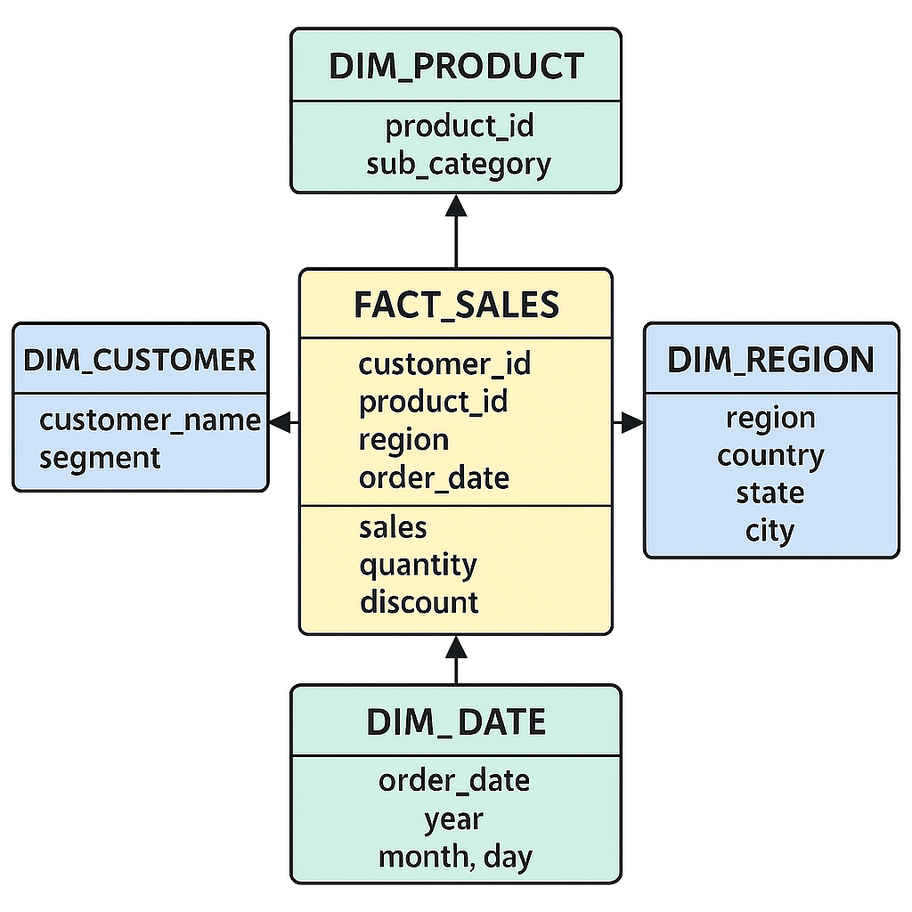

# E-Commerce Data Engineering Pipeline

End-to-end data engineering pipeline that ingests raw e-commerce sales CSVs into AWS S3, cleans and incrementally loads records with AWS Glue (PySpark), models a Star Schema in Databricks, and produces aggregated Parquet views for Power BI reporting.

## Architecture

### Pipeline Stages

1. **Raw Zone (`raw/`)**: Source `sales_data.csv` uploaded to S3.
2. **Staging Zone (`staging/`)**: `notebooks/01_data_cleaning_glue.py` parses dates, casts numeric columns, removes invalid rows/duplicates, and writes Parquet files.
3. **Curated Zone (`curated/`)**: `notebooks/02_incremental_load_glue.py` checks existing curated Parquet objects via S3 and appends only records newer than the latest processed `Order_Date`.
4. **Warehouse Zone (`warehouse/`)**: `notebooks/03_fact_dim_databricks.ipynb` builds normalized dimension tables and `fact_sales`.
5. **Analytics Zone (`warehouse/analytics/`)**: `notebooks/04_analytics_view.ipynb` generates aggregated KPIs (`sales_summary` and `top_products`) for BI dashboards.

## Data Model (Star Schema)

| Table | Description |
|-------|-------------|
| `fact_sales` | Transaction metrics (`sales`, `quantity`, `discount`, `profit`) linked to dimensions |
| `dim_customer` | Customer ID, name, segment, and country |
| `dim_product` | Product ID, name, category, and sub-category |
| `dim_region` | Surrogate `region_id` with region, country, state, city, and postal code |
| `dim_date` | Order date calendar attributes (`year`, `month`, `day`, `week`) |

## Tech Stack

See [Docs/tech_stack.txt](Docs/tech_stack.txt):

- **Storage**: AWS S3 (Parquet)
- **ETL**: AWS Glue, PySpark, Boto3
- **Modeling**: Databricks (PySpark)
- **Analytics & BI**: Spark SQL, Power BI

## Running the Pipeline

1. Configure your S3 bucket paths in `config/pipeline_config.json` and the `BUCKET_NAME` constant in the Glue scripts/notebooks.
2. Upload `sales_data.csv` to `s3://<bucket>/raw/sales_data.csv`.
3. Run `notebooks/01_data_cleaning_glue.py` and `notebooks/02_incremental_load_glue.py` in AWS Glue.
4. Execute `notebooks/03_fact_dim_databricks.ipynb` followed by `notebooks/04_analytics_view.ipynb` on Databricks.
5. Connect Power BI to the `warehouse/analytics/` Parquet outputs or run queries from `sql/analytics_queries.sql`.

## Author

**Jayant Sharma**  
Email: jayant.sharma2023@vitstudent.ac.in
