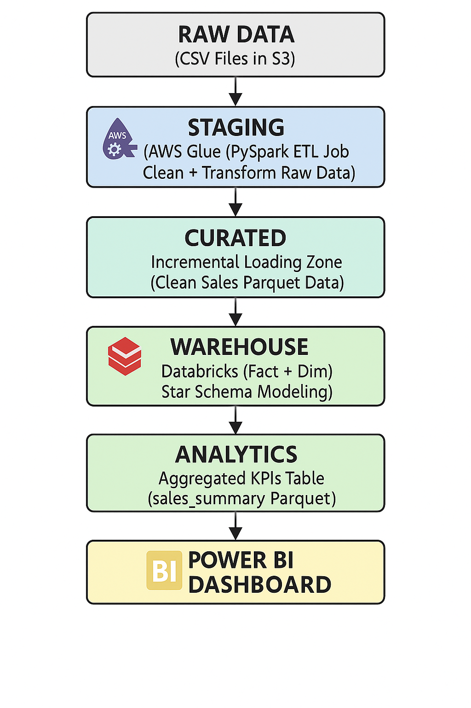

# E-Commerce Data Engineering Pipeline

End-to-end data engineering pipeline that ingests raw e-commerce sales CSVs into AWS S3, cleans and incrementally loads records with AWS Glue (PySpark), models a Star Schema in Databricks, and produces aggregated Parquet views for Power BI reporting.

## Architecture



### Pipeline Stages

1. **Raw Zone (`raw/`)**: Source `sales_data.csv` uploaded to S3.
2. **Staging Zone (`staging/`)**: [01_data_cleaning_glue.py](notebooks/01_data_cleaning_glue.py) parses dates, casts numeric columns, removes invalid rows and duplicates, and writes Parquet files.
3. **Curated Zone (`curated/`)**: [02_incremental_load_glue.py](notebooks/02_incremental_load_glue.py) checks existing curated Parquet objects via S3 and appends only records newer than the latest processed `Order_Date`.
4. **Warehouse Zone (`warehouse/`)**: [03_fact_dim_databricks.ipynb](notebooks/03_fact_dim_databricks.ipynb) builds dimension tables and `fact_sales`.
5. **Analytics Zone (`warehouse/analytics/`)**: [04_analytics_view.ipynb](notebooks/04_analytics_view.ipynb) generates aggregated KPIs (`sales_summary` and `top_products`) for BI dashboards.

## Data Model (Star Schema)


| Table | Description |
|-------|-------------|
| `fact_sales` | Transaction metrics (`sales`, `quantity`, `discount`, `profit`) linked to dimensions |
| `dim_customer` | Customer ID, name, segment, and country |
| `dim_product` | Product ID, name, category, and sub-category |
| `dim_region` | Surrogate `region_id` with region, country, state, city, and postal code |
| `dim_date` | Order date calendar attributes (`year`, `month`, `day`, `week`) |

## Tech Stack

From [Docs/tech_stack.txt](Docs/tech_stack.txt):

- **Storage**: AWS S3 (Parquet)
- **ETL**: AWS Glue, PySpark, Boto3
- **Modeling**: Databricks (PySpark)
- **Analytics & BI**: Spark SQL, Power BI

## Project Structure

```text
ecommerce-data-pipeline/
├── config/
│   └── pipeline_config.json
├── Docs/
│   ├── project_summary.pdf
│   ├── schema_design.png
│   └── tech_stack.txt
├── notebooks/
│   ├── 01_data_cleaning_glue.py
│   ├── 02_incremental_load_glue.py
│   ├── 03_fact_dim_databricks.ipynb
│   └── 04_analytics_view.ipynb
├── Screenshots/
│   └── architecture_diagram.png
├── sql/
│   └── analytics_queries.sql
├── .gitignore
├── README.md
└── requirements.txt
```

## Running the Pipeline

1. Install local dev dependencies if needed (`pip install -r requirements.txt`) and verify bucket settings in [pipeline_config.json](config/pipeline_config.json).
2. Upload `sales_data.csv` to `s3://ecommerce-data-pipeline-jayant/raw/sales_data.csv`.
3. Run the two AWS Glue jobs (`01_data_cleaning_glue.py`, then `02_incremental_load_glue.py`).
4. Run `03_fact_dim_databricks.ipynb` and `04_analytics_view.ipynb` in Databricks.
5. Connect Power BI to `warehouse/analytics/` or run ad-hoc checks from [analytics_queries.sql](sql/analytics_queries.sql).

## Documentation

- Project overview PDF: [Docs/project_summary.pdf](Docs/project_summary.pdf)

## Author

**Jayant Sharma**  
Email: jayant.sharma2023@vitstudent.ac.in
